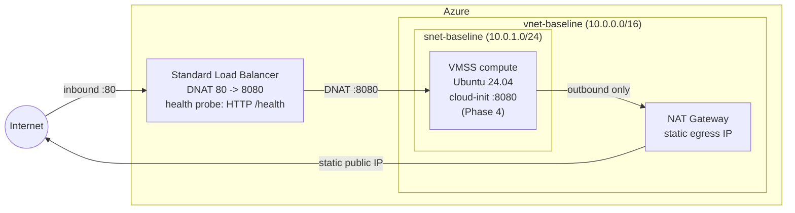

# azure-vpc-baseline

A production-grade Azure network baseline built with Terraform: private compute, deterministic egress, and edge-based ingress — no public IPs on workloads, ever.

> Learning-focused build, implemented phase by phase. Phases 1–3 complete; compute and hardening are in flight (see [Roadmap](#roadmap)).

## Architecture



## Design principles

- **Zero public IPs on compute** — instances are reachable only through the Load Balancer; all outbound traffic leaves through a dedicated NAT Gateway with a single static IP.
- **Deterministic egress** — `disable_outbound_snat = true` on the LB rule forces egress exclusively via the NAT Gateway. One IP to allowlist, no SNAT port exhaustion.
- **Standalone resource blocks** — subnets, associations, and pools are declared as separate resources (not inline) to avoid drift and circular references.
- **Consistent naming** — `rg-`, `vnet-`, `snet-`, `pip-`, `nat-`, `lb-`, `nsg-` prefixes across every resource.

## What's built

| Phase | Scope | Status |
|-------|-------|--------|
| 1 | Resource group, VNet, subnet, NSG placeholder | ✅ |
| 2 | NAT Gateway + static public IP + subnet association | ✅ |
| 3 | Standard LB, public frontend, HTTP health probe (`/health` on 8080), 80→8080 DNAT rule, backend pool | ✅ |
| 4 | VMSS (Ubuntu 24.04, cloud-init Python service on 8080) | 🔜 |
| 5 | NSG rules + end-to-end validation | 🔜 |

## NSG design (Phase 5)

Azure Standard LB is a pass-through L4 DNAT balancer — the backend NIC sees the **original client IP**, not the LB. Health probes originate from the platform IP `168.63.129.16` (`AzureLoadBalancer` service tag). Correct rules therefore require both:

- Allow TCP 8080 from `AzureLoadBalancer` (health probes)
- Allow TCP 8080 from `Internet` (real client traffic — without this, probes go green while every request drops)
- Explicit deny for all other inbound

## Usage

```bash
terraform init
terraform plan
terraform apply
```

Configuration is via variables (location defaults to `eastus`, CIDRs, SKUs). No state backend yet — local state for the learning phase.

## Layout

```
main.tf       # network, NAT, load balancer resources
variables.tf  # location, CIDRs, SKUs
outputs.tf    # subnet id, NAT egress IP, LB IP
```

## License

MIT
