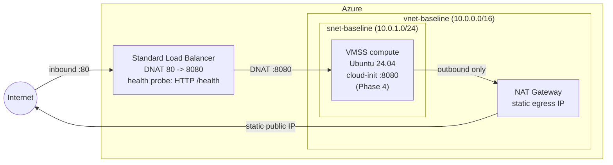

# azure-vnet-baseline

An Azure network baseline I'm building with Terraform to get the foundations right: private subnets, outbound traffic through a NAT gateway with a single static IP, and inbound traffic through a Standard Load Balancer. VMs never get public IPs of their own.


Still a work in progress. Phases 1-4 (network, NAT, load balancer, VMSS compute) are done, NSG hardening and end-to-end validation come next.

## Architecture



## How traffic flows

Inbound: clients hit the load balancer's public IP on port 80, which DNATs to port 8080 on the backend pool. The Standard LB is a pass-through L4 balancer, so the backend NICs see the original client IP, not a load balancer address. That comes back around in Phase 5 when it's time to write NSG rules.

Outbound: the subnet sits behind a NAT gateway with one static public IP, so everything leaves from a single predictable address. The LB rule also sets `disable_outbound_snat = true`, which stops the load balancer from quietly becoming a second egress path.

Health checks: an HTTP probe asks for `/health` on 8080 every 5 seconds, and an instance gets pulled after 2 failures. Probes come from `168.63.129.16`, which is what the `AzureLoadBalancer` service tag covers.

## Design decisions

- **No public IPs on compute.** Inbound only through the LB, outbound only through the NAT gateway. That means one static egress IP to allowlist anywhere, and no SNAT port exhaustion to think about.
- Subnets and associations live as separate resources instead of inline blocks. More verbose, but no drift weirdness and no circular dependencies when resources reference each other.
- Naming is one scheme throughout: `rg-`, `vnet-`, `snet-`, `pip-`, `nat-`, `lb-`, `nsg-`, all built off a single `project_name` variable.
- Standard SKU everywhere. Basic public IPs are retired at this point anyway, and NAT gateway integration wants Standard on both the IPs and the LB.

## Roadmap

| Phase | Scope | Status |
|-------|-------|--------|
| 1 | Resource group, VNet, subnet, NSG placeholder | ✅ |
| 2 | NAT Gateway + static public IP + subnet association | ✅ |
| 3 | Standard LB, public frontend, HTTP health probe (`/health` on 8080), 80→8080 DNAT rule, backend pool | ✅ |
| 4 | VMSS (Ubuntu 24.04, cloud-init Python service on 8080) | ✅ |
| 5 | NSG rules + end-to-end validation | 🔜 |

## NSG rules (Phase 5)

The gotcha here is that Azure's Standard LB doesn't hide the client. The backend NIC sees the original source IP, and health probes arrive from the platform IP `168.63.129.16`. So the NSG needs both of these, not just one:

- Allow TCP 8080 from `AzureLoadBalancer` (probes)
- Allow TCP 8080 from `Internet` (actual traffic - skip this and your probes go green while every request drops)
- Deny everything else inbound

## Usage

You'll need Terraform 1.x, an Azure subscription, and an `az login` session. No service principal required for local runs.

```bash
terraform init
terraform plan
terraform apply
```

Defaults live in variables.tf. Override them on the command line instead of editing:

```bash
terraform apply -var="project_name=demo" -var="location=eastus2"
```

Once it's up:

```bash
terraform output lb_ip            # inbound entry point, point DNS here
terraform output nat_gateway_ip   # the egress IP to allowlist downstream
```

`terraform destroy` tears it all down. State is local for now, which is fine for a learning subscription. A remote backend comes later.

### A note on azurerm 4.x

v4 changed how resource providers get registered. The provider block now takes `resource_provider_registrations` (options: `legacy` which is the default, `core`, `extended`, `all`, `none`). Everything in phases 1-3 lands under `Microsoft.Network`, which is already part of the `core` set, so there's nothing extra to register here.

## Inputs

| Name | Description | Type | Default |
|------|-------------|------|---------|
| `location` | Azure region everything deploys to | `string` | `eastus` |
| `project_name` | Name stuck onto every resource, with per-type prefixes (rg-, vnet-, snet-, and so on) | `string` | `baseline` |
| `vnet_cidr` | Address space for the vnet | `string` | `10.0.0.0/16` |
| `subnet_cidr` | App subnet range, has to fit inside vnet_cidr | `string` | `10.0.1.0/24` |
| `ssh_public_key_path` | SSH key for the Phase 4 VMSS, not used by phases 1-3 yet | `string` | `~/.ssh/id_rsa.pub` |
| `nat_gateway_sku` | NAT gateway SKU. Standard is the only one Azure supports | `string` | `Standard` |
| `pub_ip_sku` | SKU for the public IPs and the LB, needs to be Standard | `string` | `Standard` |
| `frontend_port` | Port clients connect on | `number` | `80` |
| `backend_port` | Port the app listens on. The LB forwards here and the probe asks for /health on it | `number` | `8080` |

## Outputs

| Name | Description |
|------|-------------|
| `rg_name` | Resource group everything lives in |
| `subnet_id` | App subnet ID. This is what the Phase 4 VMSS NICs plug into |
| `nat_gateway_ip` | The one static IP all outbound traffic leaves from. Allowlist this downstream |
| `lb_ip` | Public IP of the LB frontend. Point DNS here |

## Layout

```
main.tf       # network, NAT gateway, load balancer
variables.tf  # region, naming, CIDRs, ports, SKUs
outputs.tf    # subnet ID, NAT egress IP, LB frontend IP
```

## License

MIT
